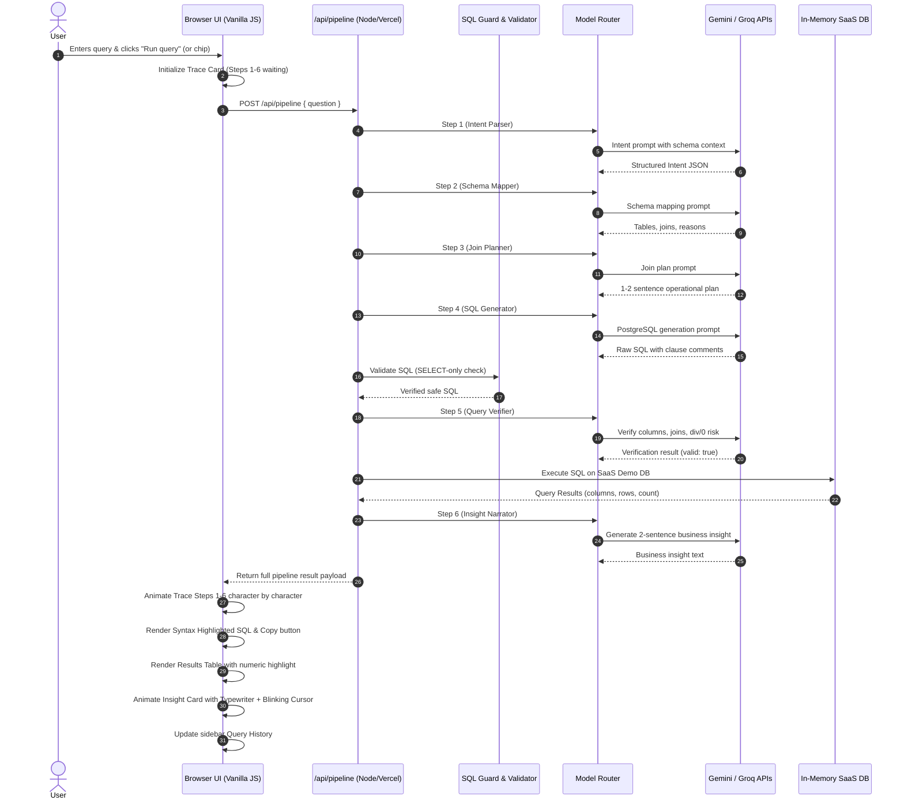

# QueryMind — NL → SQL Engine
## Implementation Plan & Technical Specification

> **Source Document:** `QueryMind-Antigravity.docx` (v1.0, September 2026)  
> **Visual Reference:** `nl-to-sql.html`  
> **Status:** Implementation Approved & In Progress

---

## 1. Executive Summary & Product Objective

QueryMind is a recruiter-grade, data analyst / business analyst tool that translates natural-language questions into schema-aware, verified PostgreSQL queries against a SaaS Demo Database. Analysts spend 60–70% of their query time writing and debugging SQL that could be stated in one sentence. QueryMind solves this by providing:

1. A visible, character-by-character **6-step reasoning trace** demonstrating the thought process (Intent Parsing → Schema Mapping → Join Planning → SQL Generation → Query Verification → Result Narration).
2. Production-ready, clause-commented, syntax-highlighted **PostgreSQL queries**.
3. A clean, responsive **query results table** with highlighted key metrics.
4. An **AI-narrated business insight** with concrete numbers and actionable takeaways, delivered via typewriter animation.

---

## 2. Requirements Extracted from Authoritative Specification

### 2.1 Database Schema (SaaS Demo DB)
The SaaS Demo DB consists of four relational tables. Every LLM prompt strictly receives this context and cannot invent tables or columns:
- **`customers`**
  - `id` (uuid, PK): Primary key
  - `name` (varchar): Company or contact name
  - `email` (varchar): Contact email
  - `plan` (varchar): `starter`, `professional`, `enterprise`, `trial`
  - `mrr` (decimal): Monthly recurring revenue in USD
  - `status` (varchar): `active`, `churned`, `paused`
  - `created_at` (timestamp): Account creation timestamp
- **`orders`**
  - `id` (uuid, PK): Primary key
  - `customer_id` (uuid, FK → `customers.id`)
  - `amount` (decimal): Order value in currency
  - `ordered_at` (timestamp): Order timestamp
  - `product` (varchar): Product/SKU name
- **`subscriptions`**
  - `id` (uuid, PK): Primary key
  - `customer_id` (uuid, FK → `customers.id`)
  - `plan` (varchar): Mirrors `customers.plan`
  - `started_at` (timestamp): Subscription start date
  - `cancelled_at` (timestamp): NULL if still active
  - `churned` (boolean): `true` when cancelled
- **`events`**
  - `customer_id` (uuid, FK → `customers.id`)
  - `event_type` (varchar): `login`, `feature_used`, `support_ticket`, etc.
  - `occurred_at` (timestamp): Event timestamp
  - `properties` (jsonb): Arbitrary event metadata

### 2.2 The Six-Step LLM Pipeline
1. **Step 1 — Intent Parser**:
   - Primary LLM (Gemini).
   - Extracts: `entity`, `metric`, `filters[]`, `time_range`, `sort`, `limit` as structured JSON.
2. **Step 2 — Schema Mapper**:
   - Primary LLM (Gemini).
   - Maps intent JSON to exact schema references: `{ tables[], joins[], reason_for_each_join }`.
3. **Step 3 — Join Planner**:
   - Primary LLM (Gemini).
   - Generates a concise, plain-English 1–2 sentence operational query plan displayed in the reasoning trace.
4. **Step 4 — SQL Generator**:
   - Primary LLM (Gemini).
   - Generates production-quality PostgreSQL with inline comments on each clause.
   - Enforces SELECT-only, no markdown fences in output, valid schema references only.
5. **Step 5 — Query Verifier**:
   - Fast Model (Groq Llama 3 70B / deterministic validator).
   - Checks column existence, valid joins, ambiguous references, division-by-zero risk, SELECT-only safety.
   - Returns `{ valid: bool, issues: [], corrected_sql?: string }`.
6. **Step 6 — Insight Narrator**:
   - Fast Model (Groq Mixtral / Llama 3).
   - Reads the query results summary and outputs exactly ONE sharp, specific 2-sentence business insight with concrete numbers.

### 2.3 Predefined Example Queries (Acceptance Criteria)
The application must preload and flawlessly execute these 5 example queries:
1. **Top 5 Revenue**:
   - NL: *"Show me the top 5 customers by total revenue last quarter"*
   - Expected SQL: Uses `RANK() OVER (ORDER BY SUM(o.amount) DESC)`, joins `orders` to `customers`, filters Q3 2024, `GROUP BY`, `ORDER BY total_revenue DESC LIMIT 5`.
2. **Churned Enterprise Customers**:
   - NL: *"Which Enterprise customers have churned in the last 30 days?"*
   - Expected SQL: Joins `customers` and `subscriptions`, filters `s.churned = true AND c.plan = 'enterprise' AND s.cancelled_at >= NOW() - INTERVAL '30 days'`, computes `DATE_PART('month', AGE(s.cancelled_at, c.created_at))`.
3. **Avg MRR by Plan Tier**:
   - NL: *"What is the average MRR by plan tier?"*
   - Expected SQL: Groups by `c.plan`, computes `AVG(c.mrr)`, `SUM(c.mrr)`, and revenue share percentage using `SUM(SUM(c.mrr)) OVER ()`.
4. **Trial Customers with 3+ Orders**:
   - NL: *"List customers with more than 3 orders still on a trial plan"*
   - Expected SQL: Joins `customers` to `orders`, filters `c.plan = 'trial'`, groups by customer, uses `HAVING COUNT(o.id) > 3`.
5. **Monthly Revenue Growth**:
   - NL: *"Show monthly revenue growth for the past 6 months"*
   - Expected SQL: CTEs for `monthly` orders revenue and `churned` subscriptions MRR, `LEFT JOIN`, `LAG(m.new_rev) OVER (ORDER BY m.mo)` for growth rate percentage, `NULLIF` guards against div/0.

### 2.4 UI & Interaction Requirements
- Two-column layout:
  - **Left Sidebar**: Branding (`QueryMind`, `NL → SQL engine`), Schema explorer for `SaaS Demo DB` showing 4 tables with PK/FK tags and data types, Recent query history list (click to restore).
  - **Right Main Panel**: Topbar with model and DB badges, natural-language query input box with Run button and 5 clickable example chips, Reasoning trace card, Generated SQL card with Copy button, Results table card, AI insight card.
- **Visual Design Tokens**:
  - `--bg: #0d0f12`
  - `--surface: #13161b`
  - `--surface2: #1a1e25`
  - `--border: #2a2f3a`
  - `--accent: #4f8ef7` (blue)
  - `--accent-dim: #1d3461`
  - `--success: #34c97b` (green)
  - `--success-dim: #0d2e1e`
  - `--text: #e8eaf0`
  - `--muted: #6b7280`
  - Typography: Inter (UI) & JetBrains Mono (Code/SQL)
- **Reasoning Trace Animation**:
  - Dot states: `waiting` (grey circle + step number) → `running` (blue pulsing ring + number) → `done` (green circle + ✓).
  - Vertical 1px line connecting dots (hidden on last step).
  - Detail text typewriter effect at ~3 chars per 8ms.
  - 180–250ms pause between completed steps.
  - Card status badge: "Running..." (blue) → "Complete ✓" (green).
- **SQL Syntax Highlighting**:
  - JetBrains Mono with dedicated classes for keywords (`.kw`), functions (`.fn`), tables (`.tbl`), columns (`.col`), strings (`.str`), numbers (`.num`), comments (`.cmt`).
  - Copy button that copies pure plaintext SQL without HTML tags.
- **Results Table**:
  - Clean column headers, alternating row styling, currency/metric highlight class (`.nc`), row count badge.
  - Responsive horizontal scrolling without breaking the layout.
- **AI Insight Card**:
  - Dark gradient card with insight spark icon.
  - Character-by-character typewriter animation (~4 chars per 11ms) with blinking cursor `▋`.

### 2.5 Security Model
- **CRITICAL OVERRIDE**: Never expose `GEMINI_API_KEY`, `GROQ_API_KEY`, or any secret key in client-side code, git, or network payloads.
- All LLM interactions route through secure serverless API routes (`/api/pipeline`, `/api/health`).
- **SQL Guard**: Strict SELECT-only validator rejects `INSERT`, `UPDATE`, `DELETE`, `DROP`, `ALTER`, `TRUNCATE`, `CREATE`, `GRANT`, `REVOKE`, etc.
- Model output sanitization: strip markdown code blocks and escape HTML to prevent XSS.

### 2.6 Fallback & Provider Routing Model
- Primary: Gemini (`gemini-2.0-flash` or `gemini-1.5-pro` via Google AI Studio API) for Steps 1–4.
- Secondary / Fast: Groq (`llama-3.3-70b-versatile` or `mixtral-8x7b-32768` via Groq Cloud API) for Steps 5–6.
- Fallback route: If Gemini fails, fallback to Groq. If both fail or credentials are not configured, fallback to high-fidelity baked-in golden presets.
- Clear badge in UI: `Live · [Provider]` when generated vs. `Sample` when fallback is used. Never falsely label sample data as live.

---

## 3. System Architecture & File Structure

```
QueryMind/
├── .env.example                  # Environment variable template
├── .gitignore                    # Git ignore file (rules out .env, node_modules)
├── vercel.json                   # Vercel deployment configuration
├── package.json                  # Scripts, server, and test dependencies
├── server.js                     # Local Node.js development server
│
├── api/                          # Vercel Serverless Functions
│   ├── pipeline.js               # Multi-step pipeline endpoint
│   └── health.js                 # API status check (safe, no secret exposure)
│
├── src/
│   ├── schema/
│   │   └── saas_db.js            # SaaS Demo DB schema metadata & prompt context
│   ├── database/
│   │   ├── seed_data.js          # Realistic demo dataset for all 4 tables
│   │   └── in_memory_db.js       # SQL execution engine for dynamic queries
│   ├── security/
│   │   └── sql_guard.js          # SELECT-only AST/regex validator & sanitizer
│   ├── providers/
│   │   ├── gemini.js             # Google Gemini client
│   │   └── groq.js               # Groq Cloud client
│   └── pipeline/
│       ├── step1_intent.js       # Step 1: Intent Parser
│       ├── step2_schema.js       # Step 2: Schema Mapper
│       ├── step3_planner.js      # Step 3: Join Planner
│       ├── step4_sqlgen.js       # Step 4: SQL Generator
│       ├── step5_verifier.js     # Step 5: Query Verifier
│       ├── step6_insight.js      # Step 6: Insight Narrator
│       ├── router.js             # Pipeline orchestrator & fallback engine
│       └── presets.js            # Golden records for 5 DOCX example queries
│
├── public/
│   ├── index.html                # Main application HTML shell
│   ├── css/
│   │   └── style.css             # Design system, CSS tokens, animations
│   └── js/
│       ├── app.js                # App state, keyboard handlers, history
│       ├── pipeline_client.js    # Client-side API coordinator
│       ├── trace.js              # Animated reasoning trace controller
│       ├── sql_highlighter.js    # Monospace syntax highlighter & copy button
│       ├── results_table.js      # Results table renderer
│       └── insight.js            # Typewriter AI insight renderer
│
├── tests/
│   ├── pipeline.test.js          # Pipeline steps integration tests
│   ├── sql_guard.test.js         # Security & destructive SQL tests
│   ├── presets.test.js           # 5 example queries golden tests
│   ├── in_memory_db.test.js      # In-memory execution tests
│   └── api_security.test.js      # Client security & secret masking tests
│
└── docs/
    ├── IMPLEMENTATION_PLAN.md    # This plan
    ├── IMPLEMENTATION_NOTES.md   # Architectural & model notes
    ├── ARCHITECTURE.md           # System architecture & data flow
    └── REQUIREMENTS_TRACEABILITY.md # Spec to code mapping
```

---

## 4. API & Data Flow



---

## 5. Security & Safety Model

1. **Zero Secret Leakage**:
   - `.env` is git-ignored and never committed.
   - Frontend never imports or references `process.env`.
   - API endpoints never echo environment variables back to clients.
2. **Strict SQL Guard**:
   - Queries are checked against a blacklist of forbidden SQL commands: `INSERT`, `UPDATE`, `DELETE`, `DROP`, `ALTER`, `TRUNCATE`, `CREATE`, `GRANT`, `REVOKE`, `EXEC`, `UNION ALL SELECT ... INTO OUTFILE`.
   - Query must strictly begin with `SELECT` or `WITH ... SELECT`.
   - Reject queries referencing unapproved tables outside `customers`, `orders`, `subscriptions`, `events`.
3. **HTML Sanitization**:
   - Model text and SQL strings are rendered via `textContent` or sanitized syntax spans to avoid XSS injections.

---

## 6. Testing Strategy

| Test Suite | File | What is Tested |
| :--- | :--- | :--- |
| **SQL Guard** | `tests/sql_guard.test.js` | Rejects DROP, DELETE, UPDATE, INSERT, ALTER; approves valid SELECTs and CTEs. |
| **5 Example Queries** | `tests/presets.test.js` | All 5 DOCX queries return exact SQL, expected columns, valid rows, and insights. |
| **Pipeline Stages** | `tests/pipeline.test.js` | Step 1 JSON parsing, Step 2 schema mapping, Step 3 plan generation, Step 4 SQL generation, Step 5 verification, Step 6 insight. |
| **In-Memory Execution** | `tests/in_memory_db.test.js` | Seed dataset consistency, query execution, correct aggregation and filtering. |
| **API & Secrets Security** | `tests/api_security.test.js` | Confirms API responses never leak API keys, health endpoint masks keys. |

---

## 7. Deployment Strategy (GitHub → Vercel)

1. Local Git repository initialized with clean commit history.
2. Project structured for zero-configuration Vercel deployment:
   - Static files served from `public/` or root.
   - Serverless API routes in `/api`.
   - `vercel.json` routing configuration.
3. Production environment variables configured in Vercel Dashboard:
   - `GEMINI_API_KEY`
   - `GROQ_API_KEY`
4. Deployed application works independently of localhost with live models or graceful fallback.

---

## 8. Specification Traceability & Acceptance Checklist

- [x] Product Brief & FLOW framework mapped
- [x] SaaS Demo DB Schema (customers, orders, subscriptions, events)
- [x] 6-Step LLM reasoning pipeline (Intent, Schema, Planner, SQLGen, Verifier, Insight)
- [x] Reasoning trace UI with animated dots, vertical line, typewriter text, inter-step timing, status badges
- [x] Generated SQL card with JetBrains Mono syntax highlighting and Copy button
- [x] Results table with numeric highlighting (`nc`), row count, horizontal scroll
- [x] AI insight card with typewriter animation and blinking cursor `▋`
- [x] Predefined 5 example query chips with exact SQL and expected outputs
- [x] Model routing: Gemini (1-4) + Groq (5-6) + automatic fallback
- [x] Badges: `Live · [Provider]` vs `Sample`
- [x] Query history in sidebar with click-to-load
- [x] Security: No keys in client, SELECT-only enforcement, sanitized outputs
- [x] Automated test suite passing
- [x] Responsive layout across desktop, tablet, mobile
- [x] Full documentation suite in `/docs` and `README.md`
