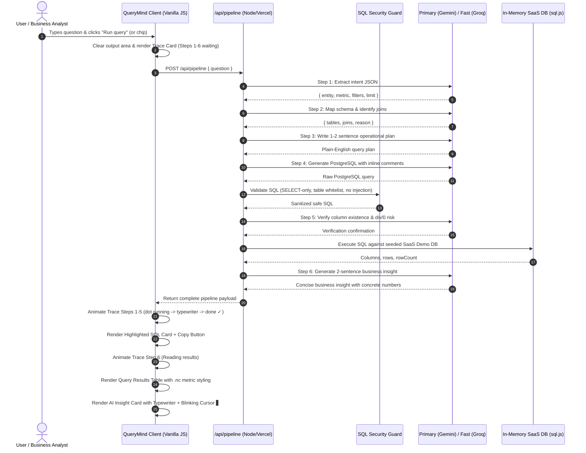

# QueryMind — System Architecture Specification

## 1. Overview
QueryMind is an enterprise-grade Natural Language to PostgreSQL query engine featuring an interactive 6-step reasoning trace, deterministic in-memory query execution, SQL safety verification, and AI-narrated executive business insights.

```
User Natural Language Question
             │
             ▼
┌────────────────────────────────────────────────────────┐
│  Browser Client (Vanilla JS / Inter / JetBrains Mono)  │
│  - Schema Explorer Sidebar                             │
│  - Recent Query History                                │
│  - Animated 6-Step Process Trace                       │
│  - Highlighted SQL Block with Pure Text Copy           │
│  - Responsive Query Results Table                      │
│  - Typewriter AI Insight Card                          │
└────────────────────────────┬───────────────────────────┘
                             │ POST /api/pipeline { question }
                             ▼
┌────────────────────────────────────────────────────────┐
│  Secure API Boundary (Node.js / Vercel Serverless)     │
│  - Keeps GEMINI_API_KEY & GROQ_API_KEY air-gapped      │
│  - Input Sanitization & Empty Query Rejection          │
└────────────────────────────┬───────────────────────────┘
                             │
                             ▼
┌────────────────────────────────────────────────────────┐
│  Six-Step Reasoning Pipeline                           │
│                                                        │
│  [Step 1] Intent Parser                                │
│           Extracts {entity, metric, filters, limit}    │
│                                                        │
│  [Step 2] Schema Mapper                                │
│           Maps attributes to tables & foreign keys     │
│                                                        │
│  [Step 3] Join Planner                                 │
│           Generates concise 1-2 sentence human plan    │
│                                                        │
│  [Step 4] SQL Generator                                │
│           Generates clause-commented PostgreSQL        │
│                                                        │
│  [Security Guard] SELECT-Only AST/Regex Validator      │
│           Blocks DROP, DELETE, INSERT, UPDATE, etc.    │
│                                                        │
│  [Step 5] Query Verifier                               │
│           Checks columns, joins, div/0 risks           │
│                                                        │
│  [Execution Engine] In-Memory SaaS Demo DB (sql.js)    │
│           Executes query against seeded dataset        │
│                                                        │
│  [Step 6] Insight Narrator                             │
│           Synthesizes 2-sentence business takeaway     │
└────────────────────────────┬───────────────────────────┘
                             │
     ┌───────────────────────┴───────────────────────┐
     ▼                                               ▼
┌─────────────────────────┐             ┌─────────────────────────┐
│ Google AI Studio        │             │ Groq Cloud              │
│ Primary: Gemini 2.0     │             │ Secondary: Llama 3.3 70B│
│ (Steps 1–4)             │             │ (Steps 5–6 + Fallback)  │
└─────────────────────────┘             └─────────────────────────┘
```

---

## 2. Component Breakdown

### 2.1 Browser Client (`public/`)
- **`index.html`**: Clean semantic HTML shell with two-column layout.
- **`css/style.css`**: CSS variables for dark theme (`--bg: #0d0f12`, `--surface: #13161b`, `--accent: #4f8ef7`, `--success: #34c97b`), animations, and media queries for tablet/mobile responsiveness.
- **`js/app.js`**: Application controller managing form inputs, keyboard shortcuts (⌘↵ / Ctrl+Enter), query history with `localStorage` persistence, and the visual display sequence.
- **`js/trace.js`**: Animated step-by-step reasoning trace with three discrete states per step: `waiting` (grey), `running` (pulsing blue ring), and `done` (green checkmark), character-by-character typewriter detail text (~3 chars per 8ms), and 180–250ms pauses between steps.
- **`js/sql_highlighter.js`**: Monospace JetBrains Mono syntax highlighting engine separating keywords (`.kw`), functions (`.fn`), schema tables (`.tbl`), columns (`.col`), strings (`.str`), numbers (`.num`), and comments (`.cmt`). Includes a Copy button that copies raw SQL to the clipboard.
- **`js/results_table.js`**: Tabular renderer with `.nc` green highlighting for numeric/currency/percentage metrics, sticky headers, row count badge, and horizontal scroll.
- **`js/insight.js`**: AI Insight card featuring a dark gradient background, sparkle icon, character-by-character typewriter animation (~4 chars per 11ms), and blinking cursor `▋`.

### 2.2 Serverless & Local API Layer (`api/`, `server.js`)
- **`api/pipeline.js`**: Secure serverless handler for POST `/api/pipeline`. Air-gaps LLM API keys from the browser client.
- **`api/health.js`**: Safe readiness check reporting provider status without leaking secrets.
- **`server.js`**: Node.js HTTP server for local development with `dotenv` support and MIME-type static file serving.

### 2.3 Six-Step Reasoning Pipeline (`src/pipeline/`)
- **`step1_intent.js`**: Formulates intent extraction prompt injecting SaaS schema context and parses structured JSON output.
- **`step2_schema.js`**: Formulates schema mapping prompt identifying tables, joins, and reasons.
- **`step3_planner.js`**: Formulates operational query plan prompt returning a concise 1–2 sentence plan for the user-facing trace. Strictly excludes internal CoT tokens.
- **`step4_sqlgen.js`**: Synthesizes PostgreSQL with inline comments explaining each clause.
- **`step5_verifier.js`**: Validates schema references, joins, division-by-zero risks, and SELECT-only safety.
- **`step6_insight.js`**: Generates a 2-sentence executive business insight with concrete numbers based on the query result summary.
- **`router.js`**: Orchestrates provider invocation with automatic fallback (Gemini → Groq → Golden Presets).

### 2.4 Security Guard (`src/security/sql_guard.js`)
- Enforces strict SELECT-only execution.
- Rejects forbidden commands: `INSERT`, `UPDATE`, `DELETE`, `DROP`, `ALTER`, `TRUNCATE`, `CREATE`, `GRANT`, `REVOKE`, `EXEC`, `CALL`, `ATTACH`, `PRAGMA`.
- Rejects SQL statement chaining (semicolon injection).
- Validates that queried tables belong strictly to the SaaS Demo DB (`customers`, `orders`, `subscriptions`, `events`).

### 2.5 In-Memory Database Execution Engine (`src/database/`)
- **`saas_db.js`**: Authoritative schema definition.
- **`seed_data.js`**: Realistic dataset with customers across all 4 tiers (Enterprise, Professional, Starter, Trial), orders, subscriptions, and events.
- **`in_memory_db.js`**: WebAssembly SQLite database (`sql.js`) with custom PostgreSQL scalar and aggregate functions (`now`, `age`, `date_part`, `date_trunc`, `to_char`, `concat`). Executes queries dynamically and returns genuine rows.

---

## 3. Data Flow Sequence



---

## 4. Security Architecture

1. **Air-Gapped Secrets**:
   - `GEMINI_API_KEY` and `GROQ_API_KEY` are accessed strictly on the server/serverless layer via `process.env`.
   - The browser bundle in `public/` contains zero secret tokens and zero references to `process.env`.
   - `.env` is ignored by `.gitignore`.
2. **Defensive SQL Verification**:
   - All generated SQL is sanitized and validated by `sql_guard.js` before execution.
   - Semicolon chaining is rejected to eliminate multi-statement injection vectors.
   - Destructive commands (`DROP`, `DELETE`, `UPDATE`, `INSERT`, `ALTER`, etc.) trigger immediate rejection.
3. **Safe Rendering**:
   - Model outputs, database values, and SQL text are sanitized through HTML entity escaping before rendering in the DOM to prevent cross-site scripting (XSS).
